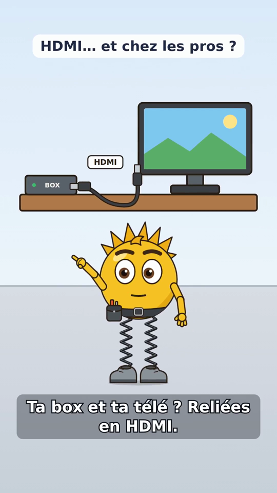
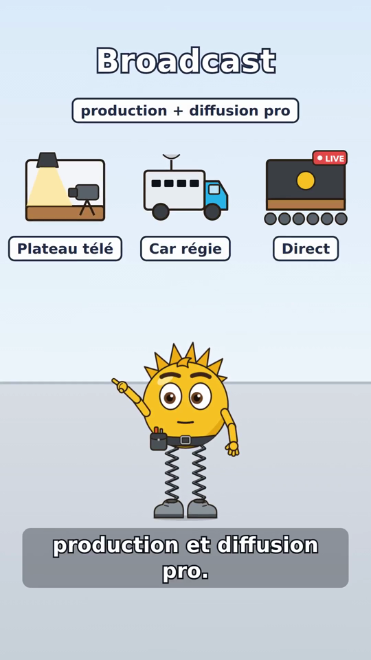
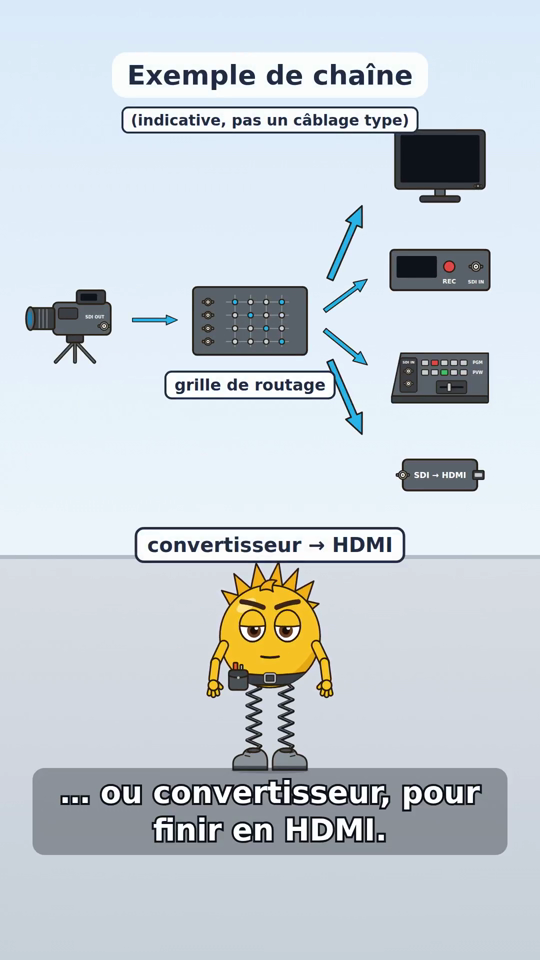
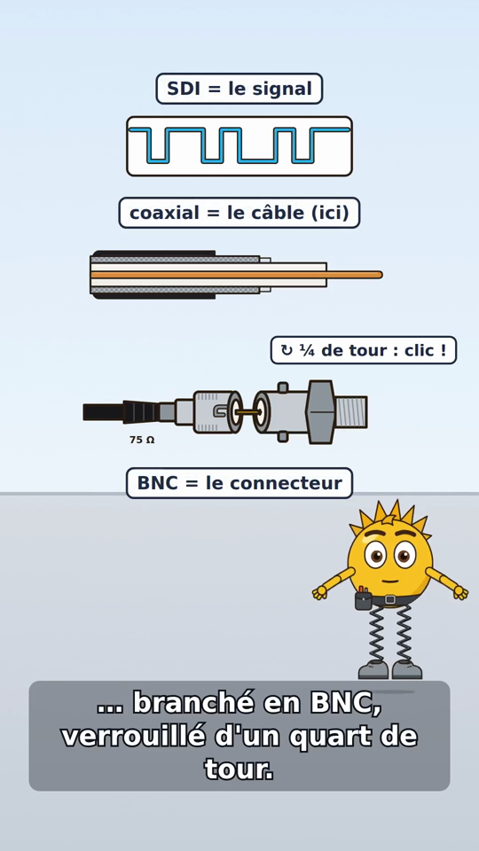
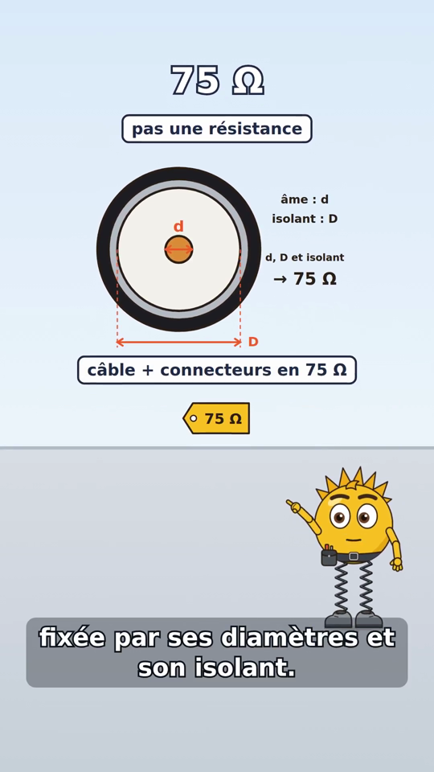
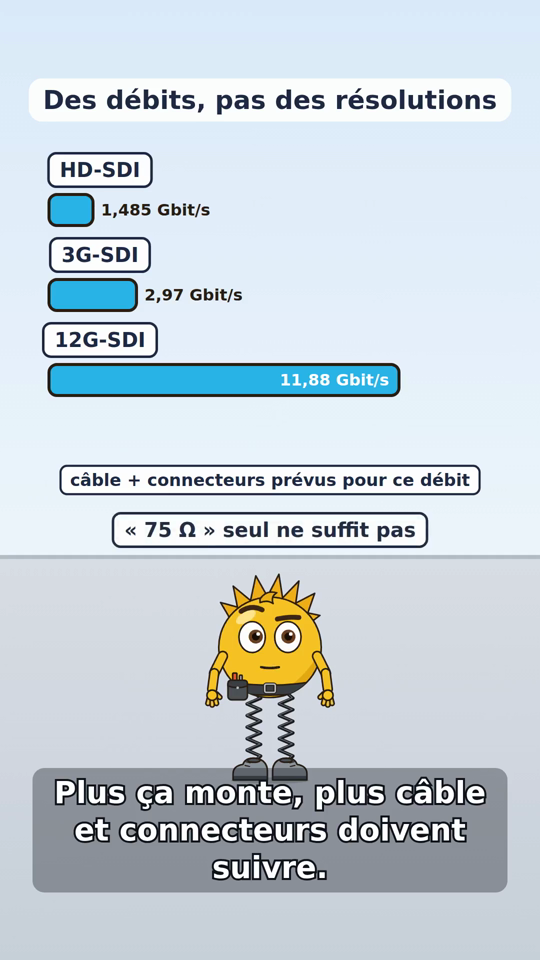
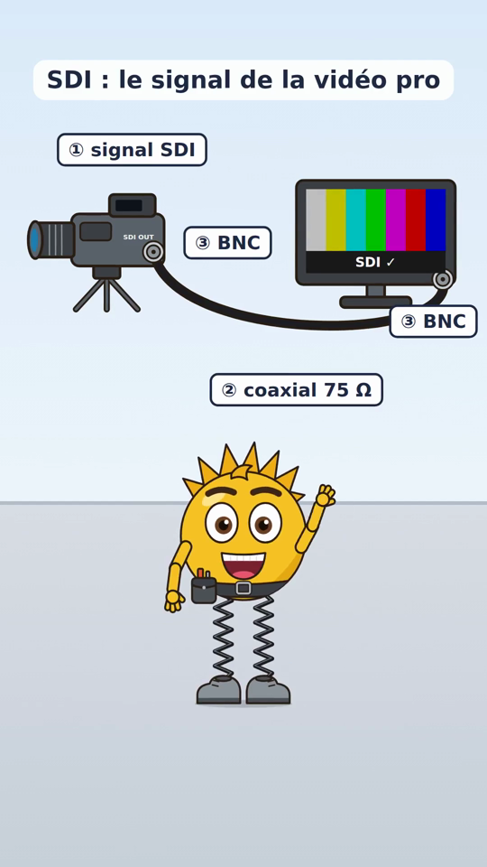

# Épisode #137 — « Voltix explique le câble SDI » : V2 éditoriale (#160)

> **Statut : V2 éditoriale proposée, rendu TECHNIQUE provisoire.** La V1 n'est **pas** approuvée pour la
> publication. Elle reste intacte (PR #158, `docs/animation/voltix-137/`, ses 23 schémas et son script) : cette V2
> est faite de **nouveaux fichiers seulement**, donc réversible. La voix (Piper locale) et la musique (générée) du
> MP4 V2 sont des **substituts gratuits**. Aucun appel payant (ElevenLabs, OpenAI). Rien n'est publié ni déployé.

[`voltix-137-v2.mp4`](voltix-137-v2.mp4) — **63,9 s** (borne 55–65 s), 1080 × 1920 (9:16), 30 i/s, H.264 + AAC 48 kHz, 5,3 Mo ; manifeste : 9 scènes `animated`, **0 repli**, aucun avertissement ; audio : −20,7 dB moyen, crête −2,4 dB.

| Accroche | Broadcast | Chaîne indicative | Signal / coaxial / BNC | 75 Ω | Débits | Conclusion branchée |
|---|---|---|---|---|---|---|
|  |  |  |  |  |  |  |

## Fichiers

| Fichier | Contenu |
|---|---|
| `voltix-137-v2.mp4`, `subtitles.srt` | rendu complet provisoire V2 et sous-titres FR |
| `storyboard.json`, `manifest.json`, `episode.json` | storyboard `lody.animation/1` figé réellement rendu, manifeste du worker, chronologie mesurée |
| `capture-*.png` | captures de contrôle (une par scène clé) |
| `planche-schemas-v2.svg` / `.png` | planche de contrôle des 11 nouveaux schémas |
| `resource/animation-assets/<schéma>/v1/*.svg` + `sdi-v2-catalogue.json` | 11 schémas V2 éditables (calques `<g id>`), catalogue `lody.animation-assets/1` séparé de celui de la V1 |
| `scripts/animation/sdi_160_assets.py` | générateur des schémas V2, du catalogue et de la planche |
| `scripts/animation/episode_voltix_160.py` | script V2 (affiché / parlé / prononciations), storyboard, contrôle des prononciations, rendu |
| `scripts/animation/musique_v2.py` | musique de test V2, générée (116 BPM) |
| `test/lody/test_episode_voltix_160.py` | 16 tests (schémas, géométrie, script TTS-safe, cadre 9:16, gel, musique) |

## 1. Diff éditorial V1 → V2 (les 10 corrections du ticket)

| # | Retour du propriétaire | V1 | V2 |
|---|---|---|---|
| 1 | Accroche : objet montré ≠ texte | « Tu vois ce câble ? » alors que seul Voltix est à l'écran | « Ta box et ta télé ? Reliées en HDMI. » **pendant** que l'on voit box → câble HDMI → télé, branchés ; puis « Et chez les pros de la vidéo ? » quand la caméra pro entre |
| 2 | Définir SDI, prononciation anglaise | « èsse dé i », jamais défini | « Du SDI : *Serial Digital Interface* » puis « interface numérique série : des bits, envoyés un par un » ; SDI dit « èss di aï » (contrôlé, voir § 3) |
| 3 | Broadcast, pont avec le HDMI | réduit à « en régie » | « Le standard du broadcast : production et diffusion pro » + plateau télé, car régie, direct ; « Comme le HDMI : de la vidéo numérique… mais pour des câbles longs et des prises verrouillées » ; écran : « Pas les mêmes prises ! » (pas d'interchangeabilité) |
| 4 | Équipements, pas que caméra → mélangeur | caméra reliée au mélangeur | chaîne **indicative** (titre « Exemple de chaîne », mention « indicative, pas un câblage type ») : caméra → grille de routage → moniteur, enregistreur, mélangeur (« qui choisit les sources »), convertisseur → HDMI ; liens = flèches symboliques |
| 5 | Audio + vidéo, sans promesse | « le son peut aussi voyager avec l'image » | « Ce même signal peut aussi intégrer le son. » ; écran : « possible, pas obligatoire » |
| 6 | SDI / coaxial / BNC ; 75 Ω expliqué | « SDI + coaxial + BNC », 75 Ω non expliqué | « Le SDI, c'est le signal. Ici, il voyage dans un câble coaxial, branché en BNC, verrouillé d'un quart de tour. » ; « Pas n'importe quel coaxial : du 75 ohms. Pas une résistance : son impédance caractéristique, fixée par ses diamètres et son isolant. » (coupe cotée d / D) ; « Plus ça monte, plus câble et connecteurs doivent suivre » + écran « « 75 Ω » seul ne suffit pas » |
| 7 | HD/3G/12G-SDI sans pause | « hache dé, èsse dé i, de trois G, èsse dé i… » (virgules = pauses) | « hache dé èss di aï, trois gé èss di aï, douze gé èss di aï » : groupes liés sans ponctuation ; « des débits, pas des résolutions » ; l'exemple « 4K à 60 i/s » est retiré (il entretenait la confusion préfixe = résolution) |
| 8 | Ton & rythme | phrases longues, scolaires ; fins de scène 8–32 images | 25 répliques courtes (une idée chacune), débit Piper 0,84 au lieu de 0,92, fins de scène 4–8 images (40 pour la conclusion, avant le fondu), apparitions synchronisées au mot (`at(réplique, %)`) |
| 9 | Musique peu convaincante | nappe douce 100 BPM | `musique_v2.py` : 116 BPM, batterie, basse syncopée, accords plaqués ; générée (aucune licence), coupée à la durée de la vidéo |
| 10 | Captures : câble flottant, « 01 » non expliqués, conclusion ambiguë | câble entre caméra et moniteur sans contact ; paquets « 01 » | conclusion sur `liaison-connectee` : câble **continu** de l'embase SDI OUT de la caméra à l'entrée du moniteur, fiches BNC **sur** les embases (vérifié par test) ; légendes numérotées « ① signal SDI → ② coaxial 75 Ω → ③ BNC » ; les « 01 » sont expliqués (« un bit après l'autre ») |

## 2. Script parlé complet V2 (TTS-safe)

Durées mesurées sur le rendu V2 (voix Piper provisoire, débit 0,84). 25 répliques, ≈ 1 040 caractères parlés.

| # | Scène | Début | Durée | Texte affiché | Texte parlé (Piper) |
|---|---|---|---|---|---|
| 1 | accroche | 0,1 s | 2,7 s | Ta box et ta télé ? Reliées en HDMI. | Ta box et ta télé ? Reliées en hache dé èm i. |
|  |  | 3,0 s | 1,4 s | Et chez les pros de la vidéo ? | Et chez les pros de la vidéo ? |
| 2 | definition | 4,6 s | 2,8 s | Du SDI : Serial Digital Interface. | Du èss di aï : sirieul didjiteul innteurfeïss. |
|  |  | 7,5 s | 1,5 s | Interface numérique série : | Interface numérique série : |
|  |  | 9,0 s | 1,4 s | des bits, un par un. | des bits, un par un. |
| 3 | broadcast | 10,8 s | 1,3 s | Le standard du broadcast : | Le standard du brodcaste : |
|  |  | 12,2 s | 1,6 s | production et diffusion pro. | production et diffusion pro ! |
|  |  | 13,9 s | 2,6 s | Comme le HDMI : de la vidéo numérique… | Comme le hache dé èm i : de la vidéo numérique, |
|  |  | 16,6 s | 1,9 s | … mais câbles longs et prises verrouillées. | mais câbles longs, et prises verrouillées. |
| 4 | chaine | 18,8 s | 3,1 s | Caméra, grille de routage, moniteur, enregistreur… | Caméra, grille de routage, moniteur, enregistreur, |
|  |  | 22,1 s | 2,0 s | … mélangeur, qui choisit les sources… | mélangeur, qui choisit les sources, |
|  |  | 24,1 s | 2,5 s | … ou convertisseur, pour finir en HDMI. | ou convertisseur, pour finir en hache dé èm i. |
| 5 | audio | 26,9 s | 2,7 s | Ce même signal peut aussi intégrer le son. | Ce même signal peut aussi intégrer le son. |
| 6 | couches | 30,0 s | 2,0 s | Le SDI, c'est le signal. | Le èss di aï, c'est le signal. |
|  |  | 32,1 s | 2,0 s | Ici, il passe dans un coaxial… | Ici, il passe dans un coaxial, |
|  |  | 34,2 s | 2,8 s | … branché en BNC, verrouillé d'un quart de tour. | branché en bé ène cé, verrouillé d'un quart de tour. |
| 7 | ohms | 37,4 s | 2,6 s | Pas n'importe quel coaxial : du 75 ohms. | Pas n'importe quel coaxial : du soixante-quinze ohms. |
|  |  | 40,0 s | 2,8 s | Pas une résistance : son impédance caractéristique, | Pas une résistance : son impédance caractéristique, |
|  |  | 42,9 s | 2,4 s | fixée par ses diamètres et son isolant. | fixée par ses diamètres et son isolant. |
| 8 | debits | 45,6 s | 3,9 s | HD-SDI, 3G-SDI, 12G-SDI : | hache dé èss di aï, trois gé èss di aï, douze gé èss di aï : |
|  |  | 49,6 s | 1,8 s | des débits, pas des résolutions. | des débits, pas des résolutions. |
|  |  | 51,5 s | 3,0 s | Plus ça monte, plus câble et connecteurs doivent suivre. | Plus ça monte, plus câble et connecteurs doivent suivre. |
| 9 | conclusion | 54,9 s | 3,2 s | Bref : le SDI, le signal de la vidéo pro. | Bref : le èss di aï, le signal de la vidéo pro. |
|  |  | 58,2 s | 3,3 s | Dans un coaxial 75 ohms, branché en BNC… | Dans un coaxial soixante-quinze ohms, branché en bé ène cé, |
|  |  | 61,6 s | 1,0 s | … et l'image arrive ! | et l'image arrive ! |

## 3. Prononciations (séparées du texte parlé, contrôlées AVANT rendu)

Le texte parlé ne contient **aucun sigle, chiffre ni symbole** (vérifié par test). Chaque terme passe par la table
`PRONUNCIATIONS` ; `episode_voltix_160.py --check-pronunciations` phonémise chaque forme parlée avec le moteur
de Piper (espeak-ng) et la compare aux phonèmes attendus. Résultat du 11/11/2026 : **9 prononciations conformes**.

| Terme affiché | Forme parlée | Phonèmes obtenus | Forme refusée (phonèmes) |
|---|---|---|---|
| SDI | èss di aï | ˈɛs dˈiʲ ˈaj | « SDI » brut → zdˈi ; « èsse dé i » (V1) → ˈɛs dˈe ˈi (épellation française refusée) |
| Serial Digital Interface | sirieul didjiteul innteurfeïss | siʁjˈœl didʒitˈœl intœʁfˈɛjs | « Serial Digital Interface » → səʁjˈal diʒitˈal ɛ̃tɛʁfˈas (lecture française) |
| HDMI | hache dé èm i | ˈaʃ dˈe ˈɛm ˈi | « HDMI » brut → dmˈi |
| HD-SDI | hache dé èss di aï | ˈaʃ dˈe ˈɛs dˈiʲ ˈaj | « HD-SDI » brut → ˌaʃdˈezdˈi |
| 3G-SDI | trois gé èss di aï | tʁwˈa ʒˈe ˈɛs dˈiʲ ˈaj | « 3G-SDI » brut → tʁwˈa ʒˈezdˈi |
| 12G-SDI | douze gé èss di aï | dˈuz ʒˈe ˈɛs dˈiʲ ˈaj | V1 : virgule entre « G » et « SDI » = pause |
| BNC | bé ène cé | bˈe ˈɛn sˈe | — |
| broadcast | brodcaste | bʁɔdkˈast | « broadcast » brut → bɹˈɔːdkast (bascule en anglais) |
| 75 Ω / 75 ohms | soixante-quinze ohms | swasˈɑ̃tkˈɛ̃z ˈɔm | — |

**Limite honnête** : le contrôle porte sur les phonèmes, pas sur l'écoute. Il prouve que Piper ne prononce plus
« zdi » ni « dmi », pas que le rendu est naturel à l'oreille. Ces formes parlées sont propres à Piper (espeak) :
avec ElevenLabs (#153), il faudra **réécouter** chaque terme (les moteurs neuronaux lisent souvent mieux « SDI »
brut que l'orthographe phonétique). La table est isolée pour être reprise par le futur raccord TTS (#153 / #121)
au lieu d'être dupliquée.

## 4. Storyboard 9:16 (chaque affirmation a son visuel)

| # | Scène | Ce qui est dit | Ce qui est montré (au mot près) | Voltix |
|---|---|---|---|---|
| 1 | accroche | box + télé en HDMI ; et chez les pros ? | `salon-hdmi` (box → câble HDMI → télé, branchés) en grand ; puis il se range à gauche « À la maison » et la caméra de plateau entre à droite « Chez les pros ? » | rebond, montre le salon, surprise |
| 2 | definition | SDI = Serial Digital Interface ; bits un par un | « SDI » en titre, « Serial Digital Interface », « interface numérique série », puis `bits-serie` (bits sur un fil, « un bit après l'autre ») | montre les bits |
| 3 | broadcast | standard du broadcast ; comme le HDMI, mais… | « Broadcast » + « production + diffusion pro » ; plateau télé, car régie, direct apparaissent ; puis « HDMI : vidéo numérique », « SDI : câbles longs, prises verrouillées », « Pas les mêmes prises ! » | montre les lieux, rebond |
| 4 | chaine | caméra, grille, moniteur, enregistreur, mélangeur, convertisseur | chaque appareil apparaît **sur son mot**, relié par une flèche ; « Exemple de chaîne (indicative, pas un câblage type) » ; « mélangeur : choisit les sources » ; « convertisseur → HDMI » | concentré |
| 5 | audio | le même signal peut intégrer le son | icônes vidéo et audio qui rejoignent le même câble ; « Vidéo + son intégré », « possible, pas obligatoire » | sourire |
| 6 | couches | SDI = signal ; coaxial ; BNC, quart de tour | signal numérique « SDI = le signal » ; coaxial en 4 couches « coaxial = le câble (ici) » ; fiche BNC mâle insérée dans l'embase « BNC = le connecteur », « ↻ ¼ de tour : clic ! » | montre, rebond au clic |
| 7 | ohms | 75 Ω ; pas une résistance ; diamètres et isolant | `coax-cotes` : coupe avec cotes d (âme) et D (isolant), « d, D et isolant → 75 Ω » ; « pas une résistance », « impédance caractéristique » ; « câble + connecteurs en 75 Ω » + étiquette | montre la coupe |
| 8 | debits | HD/3G/12G : débits ; câble et connecteurs doivent suivre | barres **proportionnelles** (1,485 / 2,97 / 11,88 Gbit/s) ; « Des débits, pas des résolutions » ; « câble + connecteurs prévus pour ce débit », « « 75 Ω » seul ne suffit pas » | concentré puis dubitatif |
| 9 | conclusion | SDI = signal de la vidéo pro ; coaxial 75 Ω, BNC ; l'image arrive | `liaison-connectee` (caméra → câble continu → moniteur, BNC montés) ; « ① signal SDI », « ② coaxial 75 Ω », « ③ BNC » ×2 ; la mire apparaît **sur** l'écran du moniteur | rebond, salut ; fondu |

Contrôles automatiques (tests) : storyboard valide et figeable avec les 3 catalogues (Voltix, SDI V1, SDI V2) ;
chaque texte à l'écran tient dans la largeur 1080 px (les styles du moteur ne passent pas à la ligne) ;
une seule marionnette par scène, synchronisation labiale active.

## 5. Contrôle technique et sources

| Affirmation de la V2 | Justification | Source |
|---|---|---|
| SDI = *Serial Digital Interface*, vidéo numérique série, utilisée en télévision et production pro | définition | TI, « SDI » (vidéo de formation, relue le 11/11/2026 : *« used for video transmission in television stations, high-end video capture and storage applications »*, transmission sur *« 75-ohm coax »*) — <https://www.ti.com/video/6038170926001> ; familles SMPTE ST 259 / 292-1 / 424 / 2082-1 |
| HD-SDI / 3G-SDI / 12G-SDI = **débits** (≈ 1,485 / 2,97 / 11,88 Gbit/s), pas des résolutions | les préfixes désignent la famille de débit ; une même résolution peut passer en plusieurs familles (ex. 1080p en 3G, ou en double lien HD) | SMPTE ST 292-1 (1,485 Gbit/s), ST 424 (2,97 Gbit/s), ST 2082-1 (11,88 Gbit/s) ; barres à l'échelle, testées (`test_rate_bars_are_proportional_to_nominal_sdi_rates`, V1) |
| Le signal SDI **peut** intégrer l'audio | audio embarqué dans l'espace auxiliaire (SMPTE ST 299-1 en HD, ST 272 en SD) ; présence non garantie | lien Lattice du ticket (RD1212) : **HTTP 404** le 11/11/2026, non relu ; normes SMPTE citées de mémoire, à confirmer par le propriétaire |
| 75 Ω = **impédance caractéristique**, pas une résistance | Z₀ = (60/√εr)·ln(D/d) : dépend du rapport des diamètres et du diélectrique. Avec les proportions dessinées (D/d = 4,6, type 1694A) et un PE expansé (εr ≈ 1,5) : Z₀ ≈ 74,8 Ω | formule classique de la ligne coaxiale ; calcul vérifié par `test_coax_dimensions_give_75_ohms` |
| Câble **et** connecteurs doivent être prévus pour 75 Ω et pour le débit ; une étiquette 75 Ω ne suffit pas | aux hauts débits, l'atténuation et l'adaptation (pertes de retour) du câble et des BNC limitent la liaison ; les fabricants qualifient leurs câbles / BNC par famille (ex. « 12G ») | page Belden du ticket : **HTTP 403** à l'accès automatique, non relue ; gamme Canare BCP-D (BNC 75 Ω qualifiés ST 2082-1) déjà citée en V1 |
| Câbles SDI plus longs que le HDMI domestique, prises BNC verrouillables | ordre de grandeur, sans chiffre affiché (la longueur réelle dépend du câble et du débit) | principe de la baïonnette BNC (V1) ; aucune distance n'est prononcée |
| Grille de routage, convertisseur SDI → HDMI, moniteur, enregistreur, mélangeur | équipements courants d'une chaîne broadcast ; présentés comme **exemple indicatif** | — |

**Géométrie des schémas V2** : la liaison de conclusion part exactement des embases lues dans les SVG V1 de la
caméra (296, 182) et du moniteur (352, 244) ; les fiches BNC sont dessinées sur ces points (test
`test_connected_link_has_no_floating_cable`). La coupe cotée garde le rapport D/d = 4,6 de la coupe V1.
Les schémas V1 (BNC mâle/femelle, coaxial longitudinal) sont réutilisés sans changement ; leurs limites connues
(fente en J en vue développée, broche de la fiche #136 qui dépasse un peu) restent à juger par un humain.

## 6. Mapping des scènes et plan de réédition ciblée (#121)

| Scène V1 | Devenir en V2 | Réutilisable | À refaire |
|---|---|---|---|
| 1 accroche | **remplacée** (HDMI + caméra pro) | caméra V1 | texte, voix, mise en scène, nouvel asset `salon-hdmi` |
| 2 liaison | **remplacée** par *definition* (SDI défini, bits en série) | — | tout |
| — | **nouvelles** : *broadcast*, *chaine* | caméra, mélangeur, moniteur V1 | tout (4 nouveaux assets) |
| 3 coupe | **fusionnée** dans *couches* (4 calques V1, sans coupe transversale petite) | calques coaxiaux V1 | texte, voix, mise en scène |
| 4 bnc | **fusionnée** dans *couches* | BNC mâle/femelle #136 | texte, voix, mise en scène |
| 5 distinction | **fusionnée** dans *couches* (signal / câble / connecteur) | onde V1 | texte, voix |
| 6 audio | **conservée en structure**, texte corrigé | câble, icônes, paquets V1 | texte, voix, sous-titre |
| 7 debits | **conservée en structure**, texte corrigé (sans exemple 4K) | 3 barres V1 | texte, voix, étiquettes |
| 8 limites | **remplacée** par *ohms* (75 Ω expliqué) + fin de *debits* | étiquette 75 Ω V1 | tout (nouvel asset `coax-cotes`) |
| 9 conclusion | **remplacée** (liaison réellement branchée) | mire V1 ; caméra/moniteur V1 intégrés à `liaison-connectee` | tout |

**À dire clairement** : la narration change partout. Comme la voix, les repères de parole et donc les durées de
**toutes** les scènes en dépendent, **les 9 scènes sont à rerendre** ; la réédition ciblée de #121 ne fait gagner
ici que sur les **assets** (14 schémas V1 et le rig Voltix réutilisés tels quels), pas sur le rendu. Elle
deviendra utile pour les itérations suivantes de la V2 (une réplique ou une scène corrigée → seule cette scène
rerendue), à condition que #121 sache recaler les scènes suivantes quand une durée change.

## 7. Estimation temps / coûts (rien n'a été dépensé)

Mesures réelles de cette session (hôte partagé, une page Chrome, voix Piper locale) : synthèse de la voix
81,6 s, rendu Remotion des 9 scènes 369,2 s, chaîne complète 7 min 33 s, mémoire max 0,47 Go.
Les rendus précédents de la session (mise au point) ont pris un temps comparable chacun.

| Poste | Volume | Coût |
|---|---|---|
| Voix ElevenLabs, une prise complète du script V2 | ≈ 1 040 caractères de texte parlé (V1 : ≈ 930) | ≈ 1 040 crédits avec `eleven_multilingual_v2` (1 crédit / caractère) ; prix selon l'abonnement du propriétaire, à vérifier avant accord |
| Voix ElevenLabs, budget réaliste | 1 prise complète + 2 reprises ciblées + écoute des sigles | ≈ 3 000 à 3 500 crédits (inchangé en ordre de grandeur par rapport à la V1 : le texte est un peu plus long) |
| Choix de la voix (#153) | 3 aperçus | ≈ 300 crédits, une seule fois pour la série (non compté ci-dessus) |
| Rendu Remotion | ≈ 7 min CPU par rendu complet sur l'hôte | aucun coût API ; licence Remotion à trancher (#118) |
| Musique | boucle générée V2 | 0 ; une piste sous licence serait un coût à décider |
| Réédition ciblée #121 | — | **aucune économie à attendre sur ce passage V1 → V2** : la narration change partout, les 9 scènes sont rerendues (§ 6) ; seules les itérations suivantes pourront ne rerendre qu'une scène |

Changer le texte après la synthèse ElevenLabs implique une nouvelle synthèse des répliques touchées : valider le
script V2 **avant** d'engager le budget.


## 8. Contrôle humain demandé avant le rendu final

1. Le script V2 (§ 2) et le storyboard (§ 4) conviennent-ils, en particulier l'accroche HDMI et la formulation
   « Comme le HDMI : de la vidéo numérique… mais pour des câbles longs et des prises verrouillées » ?
2. Écouter le MP4 : « èss di aï », « sirieul didjiteul innteurfeïss », « hache dé èm i » et les groupes HD/3G/12G
   sont-ils intelligibles avec la voix provisoire ? (À refaire avec la voix choisie dans #153.)
3. La musique V2 va-t-elle dans le bon sens (plus rythmée) ? Une piste sous licence reste à choisir.
4. Accord budgétaire ElevenLabs (§ 7) seulement après validation du texte : chaque changement de texte coûte une
   nouvelle synthèse.

## Reproduire

```bash
cd renderers/remotion && npm ci && cd -
uv run --no-sync python scripts/animation/sdi_160_assets.py                       # schémas V2 + catalogue + planche
uv run --no-sync python scripts/animation/episode_voltix_160.py --check-pronunciations \
    --piper-model /chemin/fr_FR-upmc-medium.onnx                                   # avant tout rendu
uv run --no-sync python scripts/animation/episode_voltix_160.py --storyboard-only --out /tmp/sb
uv run --no-sync python scripts/animation/episode_voltix_160.py --out /tmp/voltix-137-v2 \
    --piper-model /chemin/fr_FR-upmc-medium.onnx
```
