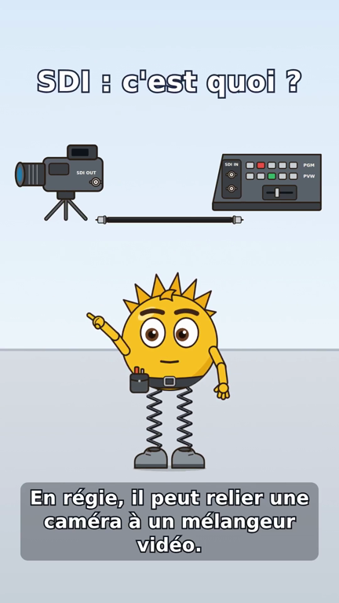
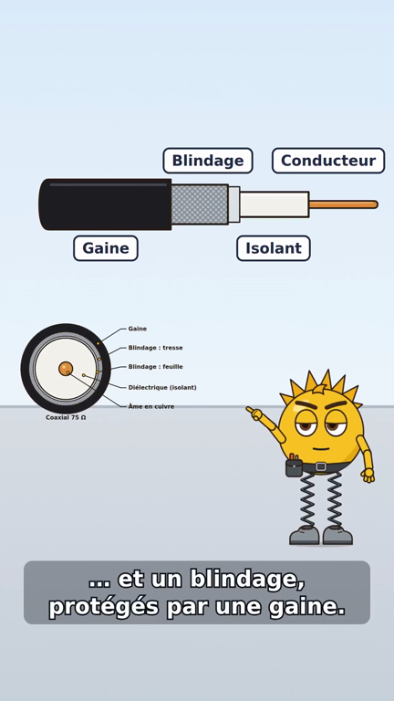
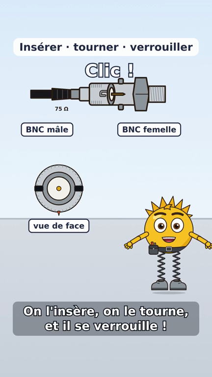
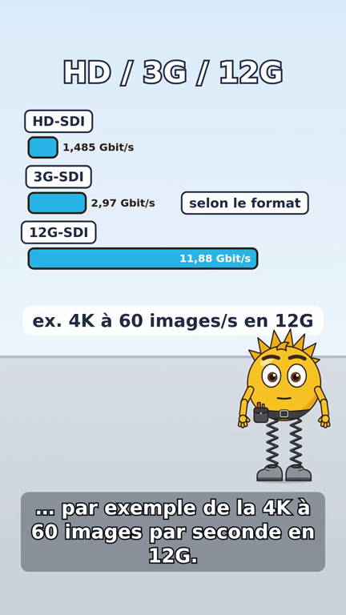
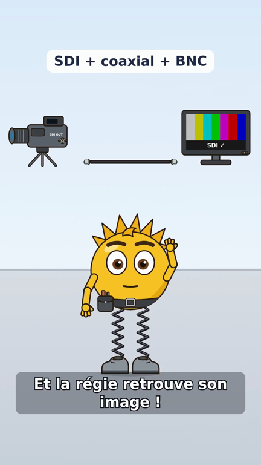
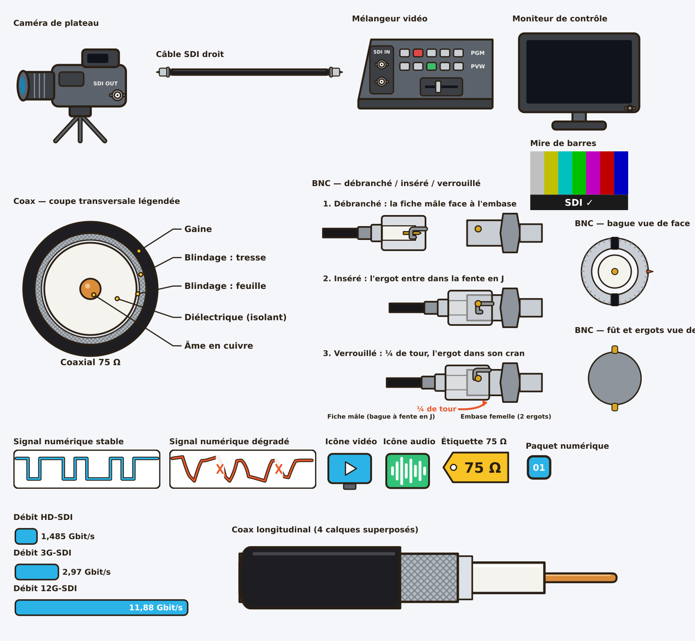

# Épisode #137 — « Voltix explique le câble SDI » (préproduction + MP4 provisoire)

> **V1 refusée par le propriétaire (11/11/2026)** — trop technique pour une vidéo de découverte. La version
> en cours est la **[V3 « du HDMI familier au SDI »](v3/README.md)** : script, storyboard, échantillons de voix.
> Ce dossier reste la référence des schémas coaxial et BNC, réutilisés par la V3.

> **Statut : préproduction livrée, rendu TECHNIQUE provisoire.** Voix et musique de ce MP4 sont des
> **substituts gratuits** (voix locale Piper, musique générée) : ce n'est **pas** le rendu final. Le rendu final
> attend : la voix de Voltix choisie et enregistrée dans sa fiche (#153), l'accord écrit du propriétaire sur le
> coût ElevenLabs, et la validation humaine des schémas ci-dessous. Aucun appel payant (ElevenLabs, OpenAI) n'a
> été fait. Rien n'est publié ni déployé.

[`voltix-137.mp4`](voltix-137.mp4) — 64,5 s, 1080 × 1920 (9:16), 30 i/s, H.264 + AAC 48 kHz stéréo, 5,5 Mo.

| Accroche | Coupe du coaxial | BNC : quart de tour | Débits | Conclusion |
|---|---|---|---|---|
|  |  |  |  |  |

## Fichiers

| Fichier | Contenu |
|---|---|
| `voltix-137.mp4`, `subtitles.srt` | rendu complet provisoire et sous-titres FR |
| `storyboard.json` | storyboard `lody.animation/1` **figé** (#119) réellement rendu (9 scènes) |
| `manifest.json`, `episode.json` | manifeste du worker #120 (scènes, replis, audio) et chronologie mesurée |
| `preset-production.json` | preset de l'épisode : bloc `template` au **format réel des templates #110** (validé par `templates.validate_fields` dans les tests), réglages projet attendus |
| `planche-schemas.svg` / `.png` | planche de contrôle de tous les schémas (vérification humaine) |
| `resource/animation-assets/<schéma>/v1/*.svg` | 23 schémas SVG éditables, un asset par pièce, calques `<g id>` nommés |
| `resource/animation-assets/sdi-catalogue.json` | catalogue `lody.animation-assets/1` importable (#119), à côté de celui de Voltix |
| `scripts/animation/sdi_137_assets.py` | générateur des schémas, du catalogue et de la planche |
| `scripts/animation/episode_voltix_137.py` | script, storyboard et rendu par la vraie chaîne (#120 / #150) |

## Script chronométré (durées mesurées avec la voix provisoire)

Le texte **affiché** (sous-titres) et le texte **parlé** (envoyé à la synthèse) sont séparés : sigles épelés,
nombres en toutes lettres, aucun symbole prononcé. Prononciations à valider à l'écoute avec la voix définitive.

| # | Scène | Début | Durée | Texte affiché | Texte parlé (synthèse) |
|---|---|---|---|---|---|
| 1 | accroche | 0.3 s | 1.1 s | Tu vois ce câble ? | Tu vois ce câble ? |
|  |  | 1.6 s | 3.6 s | En régie, il peut relier une caméra à un mélangeur vidéo. | En régie, il peut relier une caméra à un mélangeur vidéo. |
| 2 | liaison | 5.8 s | 1.7 s | C'est une liaison SDI : | C'est une liaison, èsse dé i : |
|  |  | 7.7 s | 2.0 s | de la vidéo numérique professionnelle. | de la vidéo numérique professionnelle. |
| 3 | coupe | 10.4 s | 1.1 s | Regarde à l'intérieur. | Regarde à l'intérieur ! |
|  |  | 11.7 s | 3.8 s | Ce câble coaxial possède un conducteur central, un isolant… | Ce câble coaxial possède un conducteur central, un isolant, |
|  |  | 15.7 s | 2.3 s | … et un blindage, protégés par une gaine. | et un blindage, protégés par une gaine. |
| 4 | bnc | 18.8 s | 3.7 s | Et cette fiche métallique ? C'est un connecteur BNC. | Et cette fiche métallique ? C'est un connecteur, bé ène cé. |
|  |  | 22.7 s | 2.7 s | On l'insère, on le tourne, et il se verrouille ! | On l'insère, on le tourne, et il se verrouille ! |
| 5 | distinction | 26.2 s | 3.1 s | Attention : le BNC, c'est le connecteur. | Attention : le bé ène cé, c'est le connecteur. |
|  |  | 29.5 s | 2.1 s | Le SDI, c'est le signal. | Le èsse dé i, c'est le signal. |
| 6 | audio | 32.3 s | 2.2 s | Et le son peut aussi voyager avec l'image. | Et le son peut aussi voyager avec l'image. |
| 7 | debits | 35.3 s | 6.1 s | Tu entendras parler de HD-SDI, de 3G-SDI et de 12G-SDI. | Tu entendras parler de hache dé, èsse dé i, de trois G, èsse dé i, et de douze G, èsse dé i. |
|  |  | 41.6 s | 2.7 s | Selon le format, on transporte plus de données… | Selon le format, on transporte plus de données, |
|  |  | 44.5 s | 4.0 s | … par exemple de la 4K à 60 images par seconde en 12G. | par exemple de la quatre K à soixante images par seconde, en douze G. |
| 8 | limites | 49.2 s | 2.0 s | Mais attention : ce n'est pas magique ! | Mais attention : ce n'est pas magique ! |
|  |  | 51.4 s | 2.7 s | La qualité du câble, de ses connecteurs… | La qualité du câble, de ses connecteurs, |
|  |  | 54.3 s | 2.2 s | … et sa longueur comptent énormément. | et sa longueur, comptent énormément. |
| 9 | conclusion | 57.3 s | 4.8 s | Voilà : le signal SDI, un bon coaxial et des BNC adaptés. | Voilà : le signal èsse dé i, un bon coaxial, et des bé ène cé adaptés. |
|  |  | 62.4 s | 1.7 s | Et la régie retrouve son image ! | Et la régie retrouve son image ! |

## Storyboard (9 scènes)

| # | Scène | Schémas animés | Texte écran | Voltix |
|---|---|---|---|---|
| 1 | Accroche | caméra et mélangeur entrent, câble SDI entre eux | « SDI : c'est quoi ? » | rebondit, tient le câble enroulé (geste `tenir-cable`), puis montre la régie |
| 2 | Liaison SDI | caméra → câble coaxial → mélangeur ; paquets numériques qui traversent le câble | « liaison SDI », « Signal vidéo numérique » | suit le trajet du doigt |
| 3 | Coupe du câble | coupe longitudinale en 4 calques (âme, isolant, blindage feuille + tresse, gaine) qui se séparent dans l'axe sans changer d'ordre ; puis coupe transversale légendée | Conducteur / Isolant / Blindage / Gaine, au rythme des mots | surpris puis concentré |
| 4 | Connecteur BNC | fiche mâle et embase femelle (assets #136) : approche, insertion ; vue de face : la bague tourne de 90° et masque les deux ergots | « Insérer · tourner · verrouiller », « ↻ ¼ de tour », « Clic ! » | concentré → surpris → sourire, rebond |
| 5 | SDI ≠ BNC | à gauche signal numérique, à droite fiche BNC | « SDI = signal », « BNC = connecteur » | montre l'un puis l'autre |
| 6 | Vidéo et audio | icônes vidéo et audio qui rejoignent le même câble, puis paquets | « Audio intégré possible » (pas obligatoire) | sourire |
| 7 | Débits | barres **proportionnelles** aux débits nominaux 1,485 / 2,97 / 11,88 Gbit/s | « HD / 3G / 12G », « selon le format », « ex. 4K à 60 images/s en 12G » | rebond sur l'exemple |
| 8 | Limites | câble adapté → signal net ; câble inadapté ou trop long → signal dégradé avec coupures ; étiquette 75 Ω | « Pas magique ! », « Câble et connecteurs adaptés » | dubitatif, puis montre l'étiquette |
| 9 | Conclusion | caméra → câble → moniteur ; la mire apparaît sur l'écran | « SDI + coaxial + BNC » | rebond de victoire, salut ; fondu final |

Aucune distance maximale n'est affichée ni prononcée ; la scène 8 dit seulement que câble, connecteurs et
longueur comptent. L'épisode porte sur le SDI **coaxial** (la fibre existe, elle n'est pas traitée ici).

## Schémas : exactitude et références



Les schémas sont **reconstruits en SVG vectoriel** (aucune image fabricant copiée, aucune image générée par
IA) dans le style de Voltix : contour `#2A1F14` de 6 px, aplats, palette de [la fiche Voltix](../../lody-voltix.md).

| Point vérifié | Choix | Référence |
|---|---|---|
| Couches du coaxial, de l'intérieur vers l'extérieur | âme cuivre → diélectrique → blindage (feuille **et** tresse) → gaine | construction courante des coaxiaux SDI 75 Ω (fiches West Penn Wire citées dans le ticket) |
| Proportions de la coupe transversale | âme / diélectrique ≈ 0,22 (≈ 1,0 / 4,6 mm), type « 1694A » | contrôlé par `test_cross_section_rings_and_legends` |
| Fiche BNC mâle | broche centrale **en retrait** dans la bague ; bague de verrouillage à fente en J ; sertissage ; manchon | gamme Canare BCP-D (fiches BNC 75 Ω à sertir, conformes SMPTE ST 2082-1, donc 12G-SDI) : <https://canare.eu/products/connectors/75-ohm-bnc-crimp-plugs/> |
| Embase femelle | fût avec **deux ergots diamétralement opposés**, écrou, filetage | embases BNC de panneau Canare (lien du ticket) |
| Verrouillage | insérer → l'ergot entre dans la fente → **quart de tour** → l'ergot se loge dans le cran (planche `bnc-etats` : débranché / inséré / verrouillé) | principe de la baïonnette BNC |
| Débits | HD-SDI 1,485 Gbit/s, 3G-SDI 2,97 Gbit/s, 12G-SDI 11,88 Gbit/s ; barres à l'échelle | SMPTE ST 292 / 424 / 2082 ; contrôlé par `test_rate_bars_are_proportional_to_nominal_sdi_rates` |
| Pas de confusion | ni RJ45, ni XLR, ni F ; aucune marque | `test_bnc_board_shows_three_states_with_j_slot_and_stud` |

**Limites connues, à juger par un humain** : la fente en J est montrée en vue « développée » (le pourtour déroulé),
convention de schéma, pas une vue photographique ; le BNC mâle de profil réutilise l'asset #136, dont la broche
dépasse un peu de la bague (la planche #137, elle, la montre en retrait) ; la page Barco du ticket refuse l'accès
automatique (HTTP 403) et n'a pas été relue. Dans la vidéo, la coupe transversale (scène 3) est affichée à 52 % : ses légendes
sont petites sur téléphone ; la planche, elle, est lisible. Une scène dédiée, ou un zoom, serait à décider.

## Audio et mesures du rendu

- **Voix : PROVISOIRE** — Piper `fr_FR-upmc-medium` (locuteur « pierre », licence CC BY-SA 4.0 du modèle),
  locale et gratuite ; la fiche Voltix n'a pas de voix (`audio.voice_plan` le signale). Aucun ID de voix inventé.
- **Musique : PROVISOIRE** — `scripts/animation/musique_test.py` (générée, aucune piste tierce), ≈ 20 % du niveau
  de la voix avec ducking, coupée par le worker à la durée exacte de la vidéo, fondu final.
- Durée totale 64,5 s, bornée par la narration (55–65 s visés).
- Hôte partagé, une page Chrome : synthèse 83 s, rendu des 9 scènes 387 s, chaîne complète 7 min 54 s,
  mémoire max ≈ 0,47 Go. Manifeste : 9 scènes `animated`, **0 repli**.

## Estimation des coûts (rien n'a été dépensé)

| Poste | Volume | Coût |
|---|---|---|
| Voix ElevenLabs, une prise complète | ≈ 930 caractères de texte parlé | ≈ 930 crédits avec `eleven_multilingual_v2` (1 crédit / caractère) ; prix selon l'abonnement du propriétaire, à vérifier avant accord |
| Voix ElevenLabs, budget réaliste | 1 aperçu + 2 reprises ciblées | ≈ 3 000 crédits |
| Choix de la voix (#153) | 3 aperçus de la phrase test (≈ 100 caractères) | ≈ 300 crédits, une seule fois pour toute la série |
| OpenAI Image (facultatif) | références esthétiques seulement | **non recommandé** : les schémas exacts sont déjà en SVG ; si demandé, quelques images à prix catalogue du jour, sur accord écrit |
| Rendu Remotion | 387 s CPU sur l'hôte | aucun coût API ; licence Remotion à trancher par le propriétaire (#118) |
| Musique | boucle générée | 0 (une musique sous licence serait un coût à décider) |

Le cache n'est pas à refaire : une fois la voix définitive validée, seule la voix change ; schémas, catalogue et
storyboard sont réutilisés tels quels (versions figées).

## Reproduire

```bash
cd renderers/remotion && npm ci && cd -
uv run --no-sync python scripts/animation/sdi_137_assets.py          # schémas + catalogue + planche
uv run --no-sync python scripts/animation/episode_voltix_137.py --storyboard-only --out /tmp/sb   # sans voix
uv run --no-sync python scripts/animation/episode_voltix_137.py --out /tmp/voltix-137 \
    --piper-model /chemin/fr_FR-upmc-medium.onnx                       # piper via « uvx --from piper-tts piper »
```

## Contrôle humain demandé avant le rendu final

1. Les schémas de la planche sont-ils justes (couches du coaxial, BNC mâle / femelle, trois états, quart de tour) ?
2. Les prononciations « èsse dé i », « bé ène cé », « hache dé » conviennent-elles une fois la vraie voix choisie ?
3. Accord sur le budget ElevenLabs (≈ 3 000 crédits) pour la voix définitive ?
