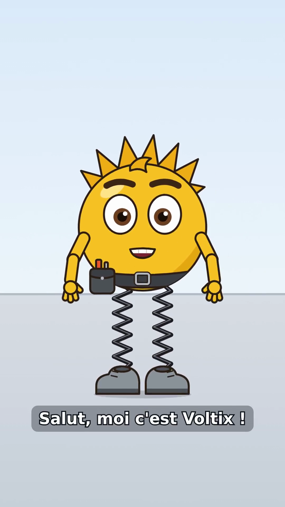
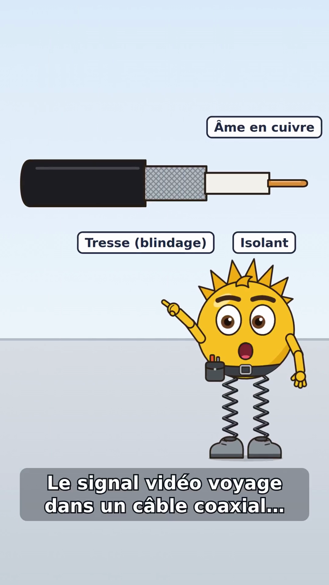
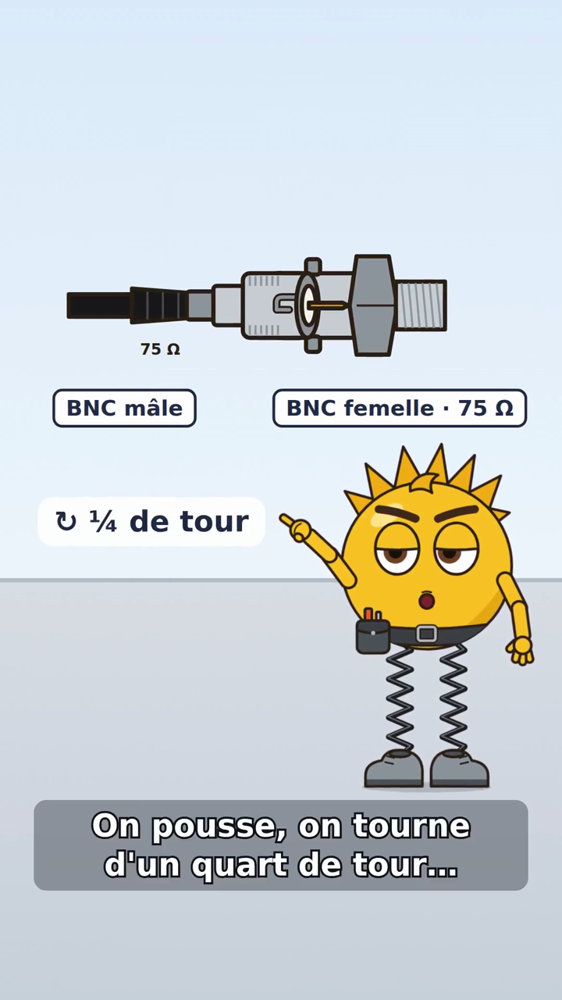

# Démo #150 — premier MP4 de Voltix parlé (provisoire)

[`voltix-150.mp4`](voltix-150.mp4) — 19,5 s, 1080×1920 (9:16), 30 images/s, H.264 + AAC 48 kHz stéréo, 2,2 Mo.
C'est un **premier rendu technique** : il n'est **pas** une vidéo finale et le rig Voltix v1 (#136) **n'est pas validé**
face à l'image source du propriétaire.

| 2 s — accueil | 7,5 s — coupe du câble coaxial | 15,5 s — fiche BNC, quart de tour |
|---|---|---|
|  |  |  |

## Chaîne réellement exécutée

`scripts/animation/demo_voltix_150.py` (environnement DEV isolé : base SQLite et dossier de données temporaires) :

projet en mode Animation 2D → fiche personnage « Voltix » → import du catalogue Voltix (#136) + asset
`coax-coupe` → storyboard `lody.animation/1` validé puis **gelé** (#119) → `AnimationConnector.preflight/submit`
(#120) → worker `run_job` (#120) → **moteur de scène Remotion** `renderers/remotion` (#150), une scène à la
fois → mixage voix + musique → assemblage `out.mp4` + `subtitles.srt` + `manifest.json`.

Résultat du manifeste : 3 scènes, toutes `animated`, **0 repli**, 586 images.

## Contenu

1. **Accueil** — rebond des ressorts, geste « saluer » puis « montrer », titre « Le câble SDI ».
2. **Coaxial** — la coupe étagée glisse dans le cadre, étiquettes Gaine / Tresse (blindage) / Isolant / Âme en
   cuivre, « 75 Ω » ; Voltix montre le câble.
3. **BNC** — fiche BNC mâle et embase femelle 75 Ω, poussée puis « ¼ de tour », « Clic ! », expressions
   concentration → surprise → sourire, salut final.

Gestes articulés (rotations aux pivots du rig), expressions, clignements automatiques, respiration, visèmes
de la bouche pilotés par l'enveloppe de `voice.wav` et le texte des répliques.

## Audio — statut honnête

- **Voix : PROVISOIRE.** La fiche Voltix n'a pas de voix choisie → synthèse locale et gratuite Piper,
  modèle `fr_FR-upmc-medium` (locuteur « pierre », licence CC BY-SA 4.0 du modèle), outil externe non
  embarqué. Aucun appel ElevenLabs / OpenAI, aucun ID de voix inventé. Une voix ElevenLabs enregistrée dans
  la fiche serait reprise par `audio.voice_plan()`, **après accord du propriétaire sur le coût**.
- **Musique : PROVISOIRE**, générée par `scripts/animation/musique_test.py` (aucune piste tierce, aucune licence).
  Niveau ≈ 20 % de la voix (−14 dB), ducking pendant la parole, fondu final, durée exacte de la vidéo.
- Mesures (`volumedetect`) : parole 6,1–8,6 s ≈ −19 dB moyen ; musique seule entre deux scènes ≈ −33 dB ;
  fin en fondu ≈ −38 dB.
- Sous-titres FR incrustés (et `subtitles.srt`) ; les sigles sont épelés pour la synthèse (« èsse dé i »,
  « bé ène cé », « soixante-quinze ohms ») mais affichés normalement (SDI, BNC, 75 ohms).

## Mesures du rendu (hôte partagé, 1 page Chrome)

- Synthèse vocale : 23 s ; rendu des 3 scènes : 118 s (40 + 34 + 44 s) ; chaîne complète : 2 min 44 s.
- CPU ≈ 110 % en moyenne ; mémoire max (processus principal) 0,46 Go — la tentative précédente, qui
  incluait le premier empaquetage webpack, a mesuré un pic ≈ 1,49 Go pour l'arbre de processus.

## Reproduire

```bash
cd renderers/remotion && npm ci && cd -
uv run --no-sync python scripts/animation/demo_voltix_150.py --out /tmp/voltix-150 \
    --piper-model /chemin/fr_FR-upmc-medium.onnx      # piper via « uvx --from piper-tts piper »
```

Fichiers versionnés ici : MP4, captures, `storyboard.json` gelé, `manifest.json`, `subtitles.srt`.
