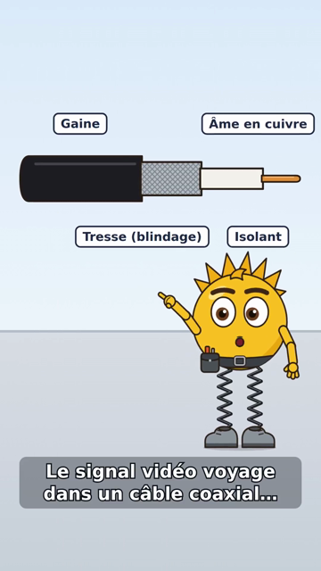
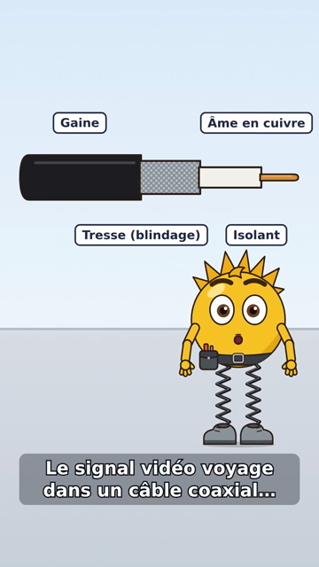

# Démo #159 — nouvelle version de Voltix ne modifiant que la scène 2 (rendu Remotion réel)

`scripts/animation/demo_reedit_159.py`, exécuté le 11/11/2026 en DEV isolé (moteur Remotion du dépôt, voix
provisoire Piper locale, musique de test générée, aucun appel payant) :

| Scène 2 « coaxial » à 8 s — V1 (geste « montrer ») | V2 (geste « saluer », expression « surprise ») |
|---|---|
|  |  |

- Modification faite avec les fonctions de l'écran « Modifier cette scène » (`scene_edit.edit_scene`), regel
  par `prepare_animation_v2`, aucun JSON saisi.
- Plan avant rendu : « 2 scène(s) réutilisée(s), 1 à refaire (≈ 41 s de rendu, ≈ 171 s évitées, mesurées) ».
- Aperçu rapide ½ : 540×960, 3 scènes rendues (cache d'aperçu séparé du rendu final), 83,5 s.
- V2 : `scenes_reused = 2`, `rendered_scenes = [2]`, `render_ms_saved = 170 623` ; rendu V2 87 s contre 241 s
  pour la V1 complète ; contrôle qualité `ok` (0 avertissement).
- V1 intacte : empreinte SHA-256 du MP4 et storyboard figé identiques après la V2.

Détails : [`demo.json`](demo.json) et [`manifest-v2.json`](manifest-v2.json). Les MP4 ne sont pas versionnés
(le script les régénère).
