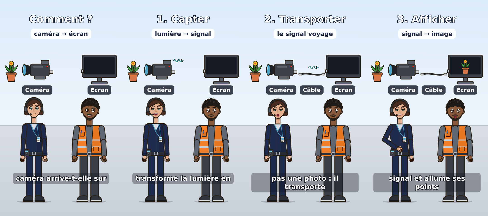

# Labo — « Comment l'image d'une caméra apparaît-elle sur un moniteur ? » (Nora et Sam)

> Ticket #174. **Projet expérimental du laboratoire**, indépendant des épisodes Voltix et du sujet SDI :
> rien n'est créé dans une instance Lody tant que le preset et les catalogues ne sont pas importés à la main.
> Aucune voix attribuée, aucun appel payant, aucune publication.

## Intention

| | |
|---|---|
| Public | novice complet (aucune notion de vidéo) |
| Notion centrale (une seule) | la **caméra capte** la lumière et la change en signal électrique, le **câble transporte** ce signal, l'**écran le décode** pour recomposer l'image |
| Format | 9:16, 1080 × 1920, 30 i/s, **43 s**, 7 scènes de 5 à 7 s, une réplique par scène |
| Personnages | **Nora** explique, **Sam** pose les questions du novice (personnages fictifs adultes du laboratoire #173) |
| Hors sujet volontaire | noms de normes, de connecteurs ou de marques, débits, résolutions |

Exactitude : « le capteur transforme la lumière en signal électrique » et « le moniteur décode le signal et
allume ses points lumineux » sont vrais pour toute chaîne caméra → câble → écran, analogique comme numérique.
« Le câble ne transporte pas une photo » insiste sur la différence entre l'image et le signal, sans entrer dans
le détail du codage.

## Dialogue, réplique par réplique

Le **texte oral** (colonne 4) est lu par la synthèse vocale et sert de sous-titre : TTS-safe, sans chiffre ni sigle.
Le **texte affiché** (colonnes 5 et 6) est un titre court à l'écran, jamais la copie de la réplique. Les étiquettes
« Caméra », « Câble », « Écran » restent sous le schéma.

<!-- dialogue:debut -->
| N° | Personnage | Durée | Texte oral | Titre affiché | Sous-titre affiché |
|---|---|---|---|---|---|
| 1 | Sam | 6 s | Nora, comment l'image de cette caméra arrive-t-elle sur l'écran, là-bas ? | `Comment ?` | `caméra → écran` |
| 2 | Nora | 6 s | Dans la caméra, un capteur transforme la lumière en signal électrique. | `1. Capter` | `lumière → signal` |
| 3 | Sam | 5 s | Et ce signal file dans le câble jusqu'à l'écran ? | `2. Transporter ?` | — |
| 4 | Nora | 7 s | Oui. Le câble ne transporte pas une photo : il transporte ce signal, image après image. | `2. Transporter` | `le signal voyage` |
| 5 | Sam | 6 s | Et l'écran, alors, il fait le chemin inverse ? | `3. Afficher ?` | — |
| 6 | Nora | 7 s | Oui : le moniteur décode le signal et allume ses points lumineux pour recomposer l'image. | `3. Afficher` | `signal → image` |
| 7 | Sam | 6 s | Donc la caméra capte, le câble transporte, et l'écran affiche ! | `En résumé` | `capte → transporte → affiche` |
<!-- dialogue:fin -->

## Storyboard

Schéma sur une ligne, de gauche à droite : **plante (sujet) → caméra → câble → écran**, construit au fil du
dialogue ; Nora à gauche, Sam à droite. Seul le personnage qui parle a la synchro labiale.

| Scène | Ce que l'on voit |
|---|---|
| 1 `question` | plante, caméra et écran **éteint** ; Sam montre l'écran, l'air perplexe |
| 2 `capter` | une onde de signal sort de la caméra ; Nora explique puis montre la caméra |
| 3 `cable` | le **câble** apparaît en fondu entre la caméra et l'écran, avec son étiquette |
| 4 `transporter` | l'onde glisse le long du câble, de la caméra vers l'écran ; Sam surpris à la fin |
| 5 `inverse` | Sam penche la tête puis montre l'écran |
| 6 `afficher` | la **plante apparaît sur l'écran** ; Nora montre l'écran |
| 7 `recap` | schéma complet, l'onde circule ; Sam récapitule, Nora salue (fondu de sortie) |

Gestes et expressions : uniquement les noms du rig #173 (`neutre`, `sourire`, `surprise`, `confusion`,
`concentration` ; `cligner`, `montrer`, `expliquer`, `pencher-tete`, `saluer`).



## Livrables

| Fichier | Rôle |
|---|---|
| [`labo-camera-moniteur/storyboard.json`](labo-camera-moniteur/storyboard.json) | storyboard `lody.animation/1`, identifiants d'assets **provisoires** en `latest` |
| [`labo-camera-moniteur/template.json`](labo-camera-moniteur/template.json) | preset de production importable (templates #110) : 30–45 s, rythme normal, consignes |
| `resource/animation-assets/labo-{camera,cable,moniteur,sujet,signal}/v1/*.svg` | assets SVG réutilisables, inertes (ni script, ni lien, ni texte) |
| `resource/animation-assets/labo-174-catalogue.json` | catalogue `lody.animation-assets/1` des cinq assets (`ast_1740000000NN`) |
| `scripts/animation/labo_174.py` | générateur unique de tout ce qui précède (`--check` pour vérifier) |
| `scripts/animation/animatic_labo_174.py` | animatic local muet via le moteur Remotion |
| [`../animation/labo-174/labo-174-animatic.mp4`](../animation/labo-174/labo-174-animatic.mp4) | animatic de contrôle (43 s, muet, sous-titres du texte oral) |

Assets réutilisables : la plante sert à la fois de sujet filmé et d'image sur l'écran (échelle 0,55, centrée
30 px × échelle au-dessus de l'ancrage du moniteur) ; l'onde de signal s'oriente toujours de la source vers la
destination ; le câble est générique (aucune norme).

## Dépendance : Nora et Sam (#173)

Le storyboard désigne Nora et Sam par les identifiants du catalogue #173 (`ast_173000000001`,
`ast_173000000002`, fichier `labo-personnages-catalogue.json`), livré par la **PR #180, non fusionnée** à la date
de ce projet. Aucun personnage n'est inventé ici ni à l'exécution : les tests refusent tout autre asset de type
personnage.

- Tant que #180 n'est pas fusionnée, le gel est vérifié contre un catalogue minimal reprenant **les noms déclarés
  du rig #173** ; le test sur le vrai catalogue est sauté.
- Une fois #180 fusionnée, ce test s'active tout seul (`test_storyboard_freezes_with_the_delivered_nora_and_sam`).
- Les décors réutilisables (#175) ne sont pas utilisés : le moteur affiche son fond par défaut. Un calque
  `decor` pourra être ajouté quand ils existeront.

## Importer dans une instance Lody (procédure manuelle)

1. Créer un **projet de test** (pas un projet en production) ; y créer les fiches `Nora` et `Sam`
   (voir `docs/lody-personnages-labo.md`, PR #180), **sans voix**.
2. Copier `resource/animation-assets/` dans le dossier de données de l'instance ; importer
   `labo-personnages-catalogue.json` puis `labo-174-catalogue.json` (`AnimationAssetRepository.import_catalog`).
3. Templates → importer `template.json` comme preset de production.
4. `remap_assets(storyboard, id_map)` puis `freeze_document` : le storyboard désigne exactement les versions
   importées.

## Vérifier et régénérer

```bash
python scripts/animation/labo_174.py --check          # livrables à jour
python -X utf8 -m pytest -q test/lody/test_labo_camera_moniteur.py
# Animatic local gratuit (npm ci dans renderers/remotion ; Nora et Sam présents) :
python scripts/animation/animatic_labo_174.py --out /tmp/labo-174 [--still]
```

Tant que #180 n'est pas fusionnée, l'animatic se rend avec `--people-root <dossier resource de #180>` et
`--cli <renderers/remotion de #180>/bin/lody-remotion.mjs` (le moteur de #180 accepte les marionnettes sans
ressorts).

## Suite possible

Voix : choisir celles de Nora et Sam avec l'outil de casting vocal (#153) — hors de ce ticket, aucun appel vocal
payant n'a été fait. Ensuite seulement, une génération réelle à partir de ce preset.
