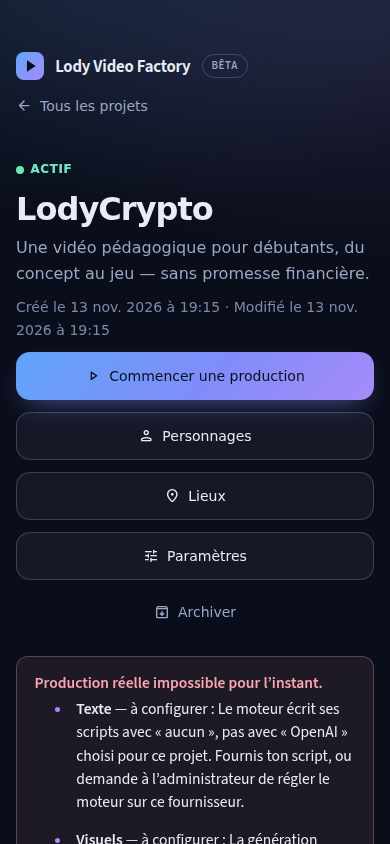
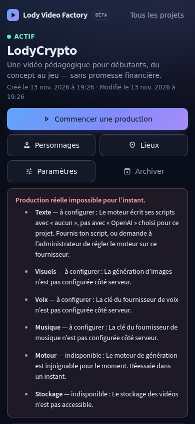
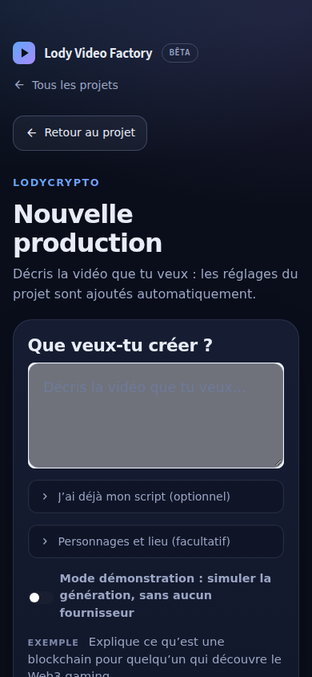
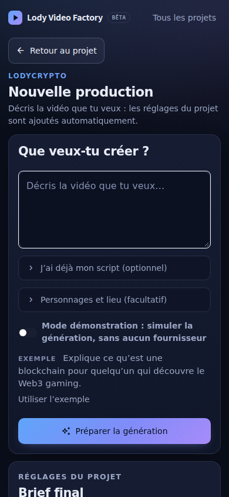

# Design system de l'interface Lody (#214)

Fondation CSS commune à toutes les pages de `webui/Lody.py` : **compacte, lisible au téléphone
(360–430 px), sans changement du moteur ni de la base**. Une seule feuille :
`webui/lody/styles.css`, injectée par `theme.inject_theme()` avec la palette d'accent du projet.

## Stratégie

1. **Jetons d'abord** (`:root` en tête de `styles.css`). Toute nouvelle règle utilise un jeton
   (`var(--space-3)`, `var(--touch)`…) plutôt qu'une valeur en dur.
2. **Densité réglée par jetons** : sur téléphone (`max-width: 640px`), on redéfinit les jetons
   (`--page-pad-x`, `--page-gap`, `--card-pad`…) au lieu de surcharger chaque composant.
3. **Composants par clé Streamlit** (`.st-key-<clé>`), jamais par classe générée `st-emotion-cache-*`
   (instable d'une version de Streamlit à l'autre).
4. **Écran par écran ensuite** : le premier lot (#214) règle l'apparence globale ; les ajustements
   propres à une vue (aides en info-bulle, regroupements) se font dans des tickets dédiés, après
   fusion des PR de fonction sur ces vues pour éviter deux refontes concurrentes.

## Jetons

| Famille | Jetons | Valeurs |
|---|---|---|
| Espacements | `--space-1` … `--space-6` | 4, 8, 12, 16, 20, 24 px |
| Texte | `--text-xs` `--text-sm` `--text-md` `--text-lg` | 12, 14, **16**, 18 px |
| Titres | `--title-page` / `--title-section` | `clamp(1.4rem, …, 1.85rem)` / 1.15rem |
| Rayons | `--radius-sm` `--radius` `--radius-lg` | 10, 14, 16 px |
| Cartes | `--card-pad` (`--card-pad-mobile` sur téléphone) | 20 px / 16 px |
| Page | `--page-pad-top` `--page-pad-x` `--page-gap` | 12 / 28 / 16 px (8 / 14 / 12 px sur téléphone) |
| Interaction | `--touch` `--focus-ring` | 44 px ; contour 2 px couleur d'accent |

Couleurs (inchangées) : `--bg`, `--surface`, `--surface-2`, `--border(-strong)`, `--text`,
`--muted`, `--faint`, `--ok`, `--warn`, `--danger`, et `--accent-1..3` injectés par projet.

## Règles appliquées par le premier lot

- **En-tête minimal** : une seule ligne (logo 24 px, nom, badge « Bêta » discret, « Tous les
  projets » à droite) ; marge haute de 8–12 px au lieu de 28 px + rangée vide. De 360 à 420 px,
  l'icône du lien de retour est masquée pour que tout tienne sur une ligne.
- **Titres contenus** : titre de page 22–30 px (au lieu de 32–48 px) ; un nom long passe à la ligne,
  il n'est jamais tronqué. Texte d'introduction en 14–16 px.
- **Actions** : toute cible (boutons primaire/secondaire/tertiaire, champs, listes déroulantes,
  sections repliables) mesure au moins 44 px. Sur la page projet au téléphone : action principale
  sur toute la largeur, actions secondaires deux par ligne.
- **Champs** : 16 px minimum (sinon Safari iOS zoome à chaque saisie) ; zone de saisie sombre (le
  conteneur Streamlit gardait le fond clair du thème par défaut, d'où un champ gris) ; texte
  indicatif à contraste ≥ 4.5:1.
- **Cartes et listes** : rembourrage 16–20 px (au lieu de 22–26 px), rayons 10–16 px.
- **Correctif Streamlit** : un bloc Markdown HTML (titre, carte, bannière) ne perd plus 16 px sous
  lui (le bloc suivant le recouvrait : titre « Personnages » coupé, bannière collée aux cartes).
- **Focus visible** sur boutons, liens, onglets, sections repliables et listes déroulantes.
- **Aucun débordement horizontal** : mots longs coupés (`overflow-wrap: anywhere`), médias limités à
  la largeur.

## Mesures avant / après (premier écran)

Position du titre de page (haut du H1, en px depuis le haut de l'écran), données de démonstration :

| Page | Téléphone 390 px avant → après | Bureau 1440 px avant → après |
|---|---|---|
| Accueil | 140 → 87 | 166 → 99 |
| Projet | 192 → 120 | 174 → 100 |
| Nouvelle production | 250 → 175 | 232 → 159 |
| Personnages / Lieux | 237–250 → 175 | 203–232 → 155–159 |

Débordement horizontal : 0 px sur les 7 pages (accueil, projet, nouvelle production, personnages,
lieux, nouveau projet, paramètres) à 360, 390 et 1440 px.

Captures réellement rendues (Chromium headless) dans [`captures/214/`](captures/214/) :
`avant-*.png` / `apres-*.png`.

| Avant (390 px) | Après (390 px) |
|---|---|
|  |  |
|  |  |

## Tests

- `test/lody/test_design_system.py` (CI) : jetons définis, toute variable utilisée est définie,
  cible tactile ≥ 44 px, champs ≥ 16 px, titre de page ≤ 2rem et jamais tronqué, densité mobile par
  jetons, absence des anciens grands rembourrages.
- `test/lody/test_design_system_browser.py` (local, Playwright + Chromium ; ignoré en CI) : en-tête
  sur une ligne à 360 / 390 / 1440 px, titre et action principale au premier écran, aucun
  débordement horizontal.

## Recette téléphone (2 minutes)

1. Ouvrir l'accueil : la marque tient sur une ligne fine tout en haut ; « Tes projets vidéo » et
   « Nouveau projet » sont visibles sans défiler.
2. Ouvrir un projet : « Tous les projets » est sur la même ligne que la marque ; « Commencer une
   production » et les boutons Personnages / Lieux / Paramètres sont visibles sans défiler.
3. Nouvelle production : la zone « Décris la vidéo… » est sombre (pas grise) ; taper dedans ne zoome
   pas la page.
4. Personnages : le titre « Personnages » est entier (pas coupé par le bouton « Ajouter »).
5. Faire glisser chaque page à gauche/droite : rien ne bouge (aucun défilement horizontal).

## Suites proposées (hors premier lot)

- Aides et descriptions explicatives derrière une info-bulle ou un « ? » vue par vue (Python, pas CSS).
- Bandeau « Production réelle impossible » replié par défaut (une ligne + détail à la demande).
- Migration progressive des valeurs restantes en dur (kit de publication, paramètres système,
  estimation) vers les jetons.
