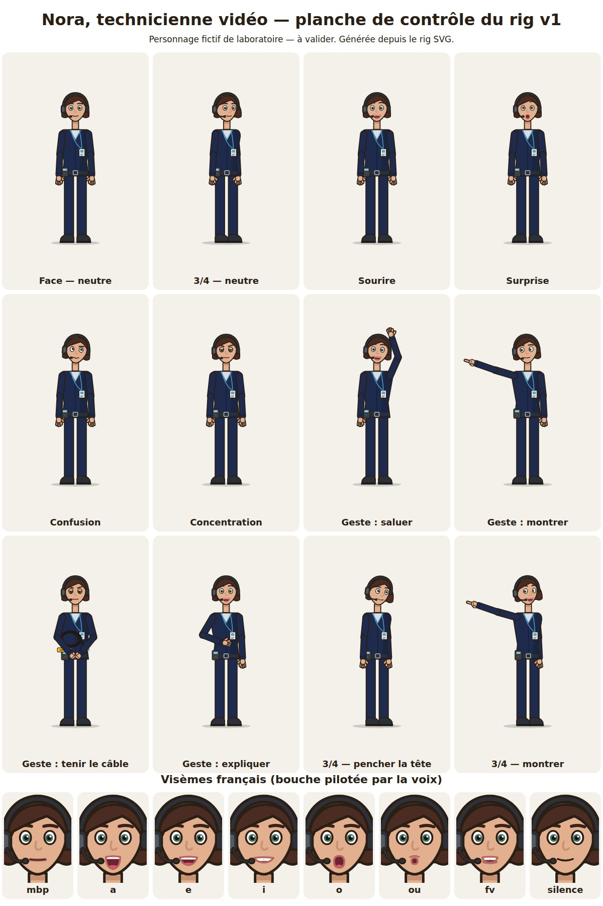
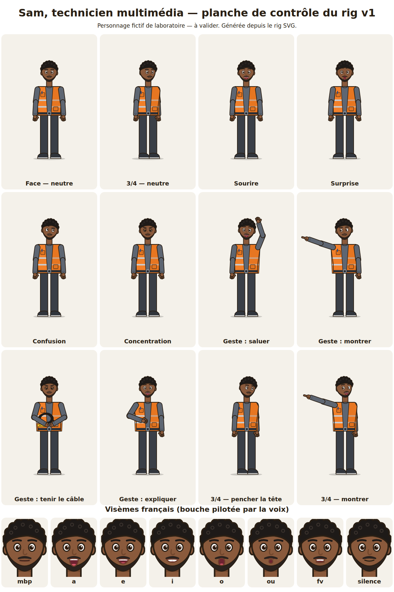
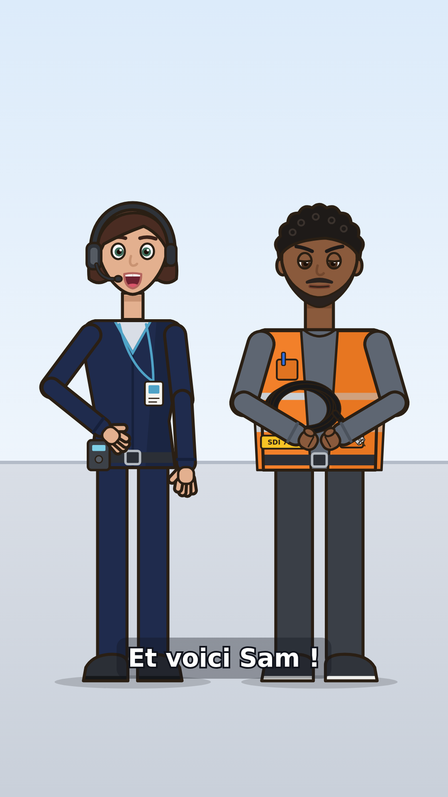

# Nora et Sam — personnages adultes du laboratoire (rigs SVG v1)

> Ticket #173. **Statut : laboratoire — à valider par le propriétaire** (validation ou demande de v2).
> Rien n'est créé dans une instance Lody tant que le catalogue n'est pas importé ; aucune voix n'est
> attribuée ; aucun crédit image ou TTS n'a été dépensé. **Voltix (#136) est inchangé** : il reste la mascotte
> provisoire du pilote ; Nora et Sam proposent un ton plus adulte pour la série.

Nora et Sam sont des personnages **fictifs**, inventés pour Lody : ils ne représentent aucune personne réelle
et ne reprennent aucun collègue ni aucune franchise existante.

| Nora | Sam |
|---|---|
|  |  |

Image du rendu Remotion local de contrôle (4 s, 1080 × 1920, sans voix) :


## Fiches personnage (à saisir dans Lody)

| Champ Lody (`characters.py`) | Nora | Sam |
|---|---|---|
| Nom | `Nora` | `Sam` |
| Description | Technicienne vidéo adulte, calme et précise ; explique la régie et le câblage avec méthode. | Technicien multimédia adulte, concret et chaleureux ; montre le matériel et le branche. |
| Éléments permanents | Tenue bleu nuit à col en V sur haut clair, liserés cyan ; casque d'intercom avec micro ; boîtier d'intercom à la ceinture ; badge sur cordon cyan ; carré brun foncé à frange asymétrique ; yeux vert-de-gris. | Gilet orange ouvert à deux bandes réfléchissantes, poche avec stylo bleu ; t-shirt et manches gris ; pantalon anthracite ; baskets à semelle blanche ; cheveux noirs courts bouclés ; barbe courte. |
| Silhouette | élancée : épaules étroites, tête un peu plus haute | trapue : épaules larges, gilet évasé |
| Notes de continuité | Ne pas changer palette ni proportions d'un épisode à l'autre ; accessoires = assets séparés ; aplats et ombre plate unique, pas de texture. | idem |
| Voix | **non choisie** | **non choisie** |

## Palettes

| Rôle | Nora | Sam |
|---|---|---|
| Peau (ombre) | `#E3B08F` (`#C99372`) | `#8A5A3C` (`#73482E`) |
| Cheveux / sourcils | `#4A2C22` / `#3A2219` | `#1E1A18` / `#1E1A18` (barbe `#2A221E`) |
| Iris / lèvres | `#3E6B5A` / `#B5655E` | `#4A2E1C` / `#6E3B2C` |
| Tenue (ombre) | bleu nuit `#1F2B4D` (`#16203B`), liseré `#4FA3C7` | gris `#5E6672` (`#4B525C`) |
| Signe distinctif | casque `#2E3238`, boîtier `#3C4148` à écran `#7FD0E8` | gilet `#F2802A` (`#D96A17`), bandes `#C9CED4` |
| Pantalon / chaussures | `#1F2B4D` / `#2B2F36` | `#3A3F47` / `#30343B`, semelle `#F1F1EE` |
| Contour commun | `#2A1F14`, 5 px à l'échelle 600 × 900 (jamais noir pur) | idem |

## Rig

Canevas 600 × 900, ancrage au sol x = 0,5 ; y = 0,98 (comme Voltix : mêmes échelles de scène). En 9:16
(1080 × 1920), une échelle de 1,3 à 1,6 garde le visage lisible.

| Fichier (relatif à `resource/`) | Rôle |
|---|---|
| `animation-assets/nora/v1/nora-face.svg`, `…/sam/v1/sam-face.svg` | vue de face (rôle `base`) |
| `animation-assets/nora/v1/nora-trois-quarts.svg`, `…/sam/v1/sam-trois-quarts.svg` | vue de trois quarts |
| `animation-assets/nora/v1/nora-rig.json`, `…/sam/v1/sam-rig.json` | poses `lody.rig/1` |
| `animation-assets/labo-personnages-catalogue.json` | catalogue `lody.animation-assets/1` importable |

**Convention** : `left` / `right` = côté **du personnage**. Calques (mêmes identifiants dans les deux vues) :
`puppet` › `legs-left|right`, `shoes`, `upper` (`neck`, `body`, `head` › `hair`, `face` › `eyes`, `pupils`,
`lids`, `eyebrows`, `nose`, `mouth-visemes`, `hair-front` ; `accessories`, `arm-left|right` › `forearm-*` ›
`hand-*`), `shadow`. Nora ajoute `headset`, `beltpack`, `badge` ; Sam `beard`, `vest`.

- **Pivots** `data-pivot` : cou (`head`), épaules, coudes, poignets, hanches (`upper`, `legs-*`), pupilles.
- **Variantes** : **mêmes noms que Voltix** (sourcils, paupières `ouverts|mi-clos|fermes`, bouches, mains
  `ouverte|poing|index`) : le moteur Remotion (synchro labiale, clignement automatique) les pilote tel quel.
- **Points d'accroche** : `slot-chest` (devant le ventre), `slot-belt`, `hand-left-slot`, `hand-right-slot`.
- **Pas de ressorts** : les gestes n'utilisent ni `lift` ni `air`. La respiration du moteur (`squash`) écrase
  légèrement le haut du corps ; les jambes ne bougent pas. `rig_pose.py` et `svgpose.mjs` acceptent désormais
  une marionnette sans `springs-*` (comportement de Voltix inchangé).

### Expressions, visèmes, gestes

- **Expressions** : `neutre`, `sourire`, `surprise`, `confusion` (tête légèrement penchée), `concentration`.
- **Visèmes français** : `mbp`, `a`, `e`, `i`, `o`, `ou`, `fv` + silence (`repos`) ; formes `sourire`,
  `grimace`. Mêmes tables de phonèmes que Voltix.
- **Gestes** (30 i/s) : `cligner` (6), `saluer` (30), `montrer` (24, index tendu), `tenir-cable` (12, accroche
  le câble SDI de Voltix devant le ventre, poings joints), `expliquer` (30, main ouverte qui accompagne la
  parole), `pencher-tete` (20).

Le câble SDI (`cable-sdi`) reste l'asset `prop` du catalogue Voltix : importer aussi ce catalogue (ou au moins
son câble) pour que `tenir-cable` affiche le câble ; sans lui, la pose reste valable, mains vides.

## Import dans Lody

1. Créer les personnages `Nora` et `Sam` dans le projet (fiches ci-dessus) — le lien se fait par le nom.
2. Copier `resource/animation-assets/` dans le dossier de données de l'instance.
3. Importer `labo-personnages-catalogue.json` avec `AnimationAssetRepository.import_catalog` (#119) ; les
   identifiants `ast_1730000000NN` sont remplacés à l'import.

## Régénérer et vérifier

```bash
python scripts/animation/humain_rig.py               # SVG + rigs + catalogue v1 (empreintes recalculées)
python scripts/animation/planche_personnages.py --png  # planches (PNG via un Chromium local, s'il existe)
python scripts/animation/demo_labo_173.py --out /tmp/labo-173   # MP4 muet de 4 s (npm ci dans renderers/remotion)
```

La v1 est immuable : une retouche se publie en `v2/` avec une nouvelle version d'asset.
`test/lody/test_personnages_labo.py` vérifie la reproductibilité, les calques, pivots et variantes, chaque pose
sur les deux vues, l'inertie des SVG, la distinction des silhouettes, que Voltix n'a pas bougé, et l'import puis
le figement d'un storyboard à deux personnages.

## Voix

Aucune voix n'est attribuée (consigne du ticket). Pour plus tard : comparer des aperçus avec l'outil de
casting vocal (#153, `docs/lody-voix-personnage.md`) — voix française native adulte, posée pour Nora, plus
chaleureuse pour Sam — puis enregistrer le choix une seule fois dans chaque fiche.
