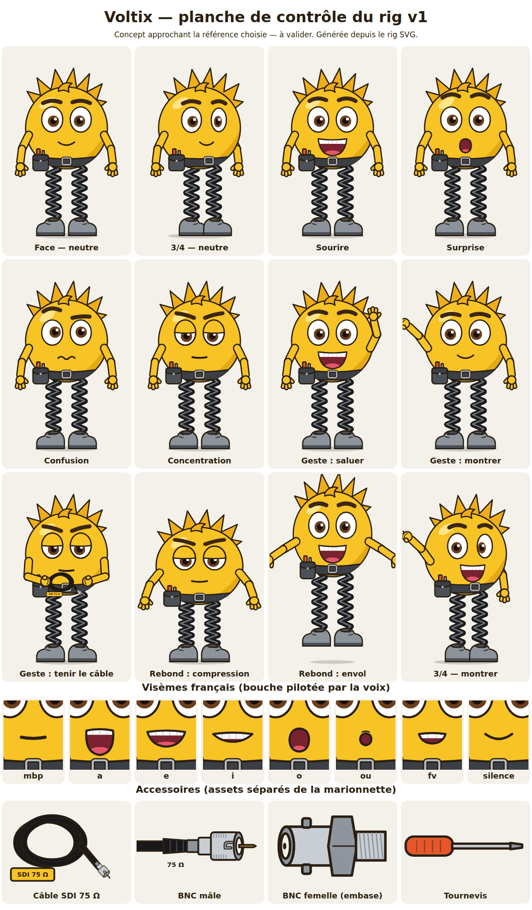

# Voltix — fiche personnage et rig SVG (v1)

> Ticket #136. **Statut : concept / rig prêt à importer** — rien n'est créé dans une instance Lody.
> Aucun identifiant de production n'existe tant que le propriétaire n'a pas importé le catalogue.
>
> **Décision du propriétaire (11/11/2026) : GO artistique provisoire** pour utiliser Voltix v1 dans un premier
> test d'animation / vidéo broadcast (#150, puis #137). Pas de refonte du design à ce stade : priorité au test
> de production bout en bout. Ce GO **n'est ni une validation artistique définitive de la série, ni
> l'approbation d'un coût API ou d'un déploiement**. Le style reste jugé assez enfantin pour le broadcast :
> d'autres personnages ou un style plus mature pourront venir ensuite, en **nouvelles versions ou nouveaux
> assets**, sans casser les vidéos qui ont figé la v1. À vérifier pendant le pilote : prononciation, mouvement
> articulé, qualité des schémas SDI/BNC.



## Référence artistique : limite à connaître

L'illustration choisie par le propriétaire (première planche ChatGPT, premier personnage) **n'est pas
accessible** dans l'environnement de l'agent qui a dessiné cette version. Le dessin suit **uniquement la
description écrite** du ticket : petite créature ronde jaune-or, mèches pointues ébouriffées, épais sourcils
foncés, grands yeux expressifs, large sourire avec petites dents, sacoche/ceinture d'outils gris charbon sur
la gauche, câble coaxial noir enroulé tenu dans les mains, jambes ressort métalliques noires, grosses
chaussures grises. C'est un **concept approchant**, pas une reproduction fidèle : la ressemblance reste à
valider contre l'image source (le propriétaire peut déposer la capture dans le ticket pour une v2). Le
propriétaire a accepté ce concept tel quel pour le pilote (voir la décision ci-dessus) : la v1 est conservée.

Choix faits en l'absence de l'image (à corriger en v2 si la référence diffère) : bras et mains de la couleur
du corps (moufles à quatre doigts) ; sacoche à **gauche de l'image** (hanche droite du personnage) ; mèches
d'un jaune plus soutenu que le corps ; pas de cou, le corps est la tête.

## Identité (à saisir dans la fiche personnage Lody)

| Champ Lody (`characters.py`) | Valeur proposée |
|---|---|
| Nom | `Voltix` (nom de travail, modifiable) |
| Description | Mascotte fictive non humaine : petite créature ronde jaune-or, énergique, attachante, techniquement compétente et légèrement maladroite. Explique la technique vidéo en bondissant sur ses jambes à ressort. |
| Éléments permanents | Corps rond jaune-or ; mèches pointues ; sourcils épais brun foncé ; grands yeux à iris brun ; ceinture gris charbon à boucle argent et sacoche avec tournevis ; deux ressorts noirs ; chaussures grises à semelle foncée. |
| Notes de continuité | Ne jamais changer la palette ni les proportions d'un épisode à l'autre ; les accessoires (câble, BNC, outil) sont des assets séparés ; jamais de texture ni d'ombrage complexe ; pas de référence à une franchise existante. Ne pas réutiliser les fiches des collègues (réservées). |
| Voix | **non choisie** — voir « Voix » ci-dessous. |

## Palette

| Rôle | Couleur |
|---|---|
| Corps, bras, mains | `#F7C325` (ombre plate unique `#E3A812`, reflet `#FFE48A`) |
| Mèches | `#EFAE17` |
| Contour (jamais noir pur), 6 px à l'échelle 600 × 900 | `#2A1F14` |
| Sourcils | `#3B2716` |
| Yeux : blanc / iris / pupille | `#FFFFFF` / `#6B3E1E` / `#1A0F08` |
| Bouche / langue | `#7A2230` / `#E5566B` |
| Ceinture / sacoche / boucle | `#3C3F44` / `#4C5157` / `#B4BAC1` |
| Ressorts (reflet) | `#1C1C1E` (`#6E7379`) |
| Chaussures / semelles | `#8C939B` / `#4B5056` |
| Manche d'outil | `#E8562A` |
| Connecteurs : métal / ombre / isolant / broche | `#C9CED4` / `#8E959C` / `#F4F3EE` / `#D9A520` |

## Proportions (canevas 600 × 900, ancrage au sol x = 0,5 ; y = 0,98)

- Corps : cercle de rayon 195 centré à (300, 370), soit ~43 % de la hauteur ; mèches jusqu'à y ≈ 86.
- Yeux : ellipses 50 × 60 (rayons) ; sourcils au-dessus, épaisseur 19.
- Ressorts : de y = 545 à 812 (≈ 30 % de la hauteur), 12 spires, écartement 124 px.
- Chaussures : sol à y = 882 ; ombre portée au sol.
- En 9:16 (1080 × 1920), une échelle de 1,2 à 1,6 garde le visage lisible sur téléphone.

## Rig

Fichiers (chemins relatifs au dossier `resource/`, identiques à ceux du manifeste) :

| Fichier | Rôle |
|---|---|
| `animation-assets/voltix/v1/voltix-face.svg` | vue de face (rôle `base`) |
| `animation-assets/voltix/v1/voltix-trois-quarts.svg` | vue de trois quarts (rôle `trois-quarts`) |
| `animation-assets/voltix/v1/voltix-rig.json` | données de poses `lody.rig/1` (rôle `rig`) |
| `animation-assets/voltix-catalogue.json` | catalogue `lody.animation-assets/1` importable (#119) |

**Convention** : `left` / `right` = côté **du personnage** (son bras gauche est à droite de l'image).

Calques nommés (mêmes identifiants dans les deux vues) : `puppet` › `springs-left|right`, `upper`
(`body`, `hair`, `hair-front`, `toolbelt`, `face` › `eyes`, `pupils`, `lids`, `eyebrows`, `mouth-visemes`,
`accessories`, `arm-left|right` › `forearm-*` › `hand-*`), `shoes`, `shadow`.

- **Pivots** : attribut `data-pivot="x y"` (épaule, coude, poignet, pied du ressort, base du haut du corps).
- **Variantes** : groupe `data-variants`, enfants `data-variant` ; une seule visible. Sourcils (neutre, joie,
  surprise, confusion, concentration), paupières (ouverts, mi-clos, fermes), bouches, mains (ouverte, poing,
  index).
- **Points d'accroche** `data-slot` : `slot-belly`, `slot-belt`, `hand-left-slot`, `hand-right-slot`. Les
  accessoires restent des assets séparés insérés à la pose.
- **Ressorts** : `lift` comprime (< 0) ou étire (> 0) les ressorts autour du pied (le sol ne bouge pas) et
  déplace `upper` ; `squash` écrase/étire le haut du corps ; `air` soulève toute la marionnette (saut).

### Expressions, visèmes, gestes (noms du manifeste)

- **Expressions** : `neutre`, `sourire`, `surprise`, `confusion`, `concentration`.
- **Visèmes français** (7 + silence) : `mbp` (m b p), `a`, `e` (é è e eu), `i` (i y et consonnes dentales),
  `o` (o au on an), `ou` (ou u ch j), `fv` (f v) ; silence = bouche `repos`. Formes expressives en plus :
  `sourire`, `grimace`.
- **Gestes** (poses-clés en images à 30 i/s, valeurs maintenues d'une clé à l'autre) : `cligner` (6),
  `saluer` (30), `montrer` (24), `tenir-cable` (12, accroche le câble SDI), `rebond` (28 : anticipation /
  compression → détente → envol → atterrissage).

Le moteur de rendu (#120) n'existe pas encore pour ce rig : `scripts/animation/rig_pose.py` applique les poses
au SVG pour **vérifier** pivots, ancrages et variantes, et produit la planche ci-dessus. Interpoler les poses
entre deux clés relève de l'adaptateur du moteur.

## Accessoires (assets `prop` séparés)

| Asset | Lisibilité technique |
|---|---|
| Câble SDI 75 Ω enroulé (`cable-sdi`) | câble coaxial noir, fiche BNC mâle à l'extrémité, étiquette « SDI 75 Ω » |
| BNC mâle (`bnc-male`) | broche centrale dorée, isolant blanc, manchon de baïonnette moleté avec fente en J, sertissage, manchon souple |
| BNC femelle (`bnc-femelle`) | embase de panneau : douille centrale dans l'isolant, fût avec deux ergots de baïonnette, écrou hexagonal, filetage |
| Tournevis (`tournevis`) | outil générique de la sacoche |

## Voix

**Aucune voix n'est choisie ni enregistrée.** Aucun appel ElevenLabs n'a été fait (coût, et la configuration
réelle n'est pas accessible à l'agent) et aucune `voice_id` n'est inventée. Critères à appliquer au catalogue
autorisé (`docs/lody-elevenlabs-voices.md`) : voix française native, jeune adulte, rapide, claire,
enthousiaste sans caricature infantile ; aucun clonage. Procédure proposée : comparer 3 voix candidates sur la
même phrase de test (« Salut, moi c'est Voltix ! Aujourd'hui, on branche un câble SDI en BNC, soixante-quinze
ohms, et ça tient ! »), puis enregistrer **une fois** dans la fiche Lody `voice_provider`, `voice_name`,
`external_voice_id` et le jeu vocal (`voice_direction`) avec un modèle réellement disponible. Ne fixer
vitesse et pauses qu'après écoute.

## Import dans Lody

1. Créer le personnage `Voltix` dans le projet (fiche ci-dessus) — le lien marionnette ↔ personnage se fait
   par le nom.
2. Copier `resource/animation-assets/` dans le dossier de données de l'instance (les manifestes y pointent).
3. Importer `voltix-catalogue.json` avec `AnimationAssetRepository.import_catalog` (#119) ; l'interface
   d'import arrive avec #120. Les identifiants `ast_1360000000NN` du fichier sont remplacés à l'import.

## Régénérer

```bash
python scripts/animation/voltix_rig.py   # SVG v1 + catalogue (empreintes recalculées)
python scripts/animation/rig_pose.py     # planche SVG (le PNG versionné en est une capture)
```

La v1 est immuable : toute retouche (à la main dans Inkscape ou via le script) se publie en `v2/`, avec une
nouvelle version de l'asset dans le catalogue. `test/lody/test_voltix_rig.py` vérifie que la v1 livrée
correspond au générateur, que chaque pose s'applique aux deux vues et que le catalogue s'importe et se fige.
